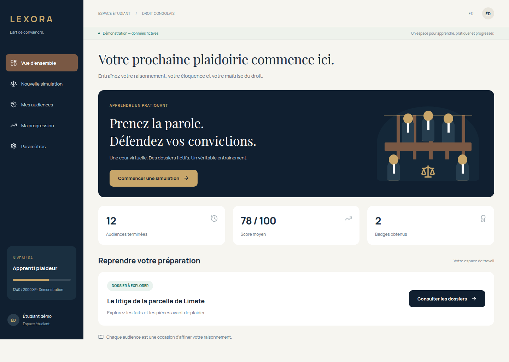

# Lexora — frontend

Application pédagogique de simulation de procès pour étudiants en droit. Interface française responsive, participation texte, capture vocale, salle 3D procédurale, pièces, verdict et progression.

**Deux modes strictement séparés :** démonstration autonome avec dossiers fictifs et scénario déterministe ; intégration Django via des adaptateurs REST/WebSocket et un contrat proposé. Aucun fournisseur IA ni backend n’est inclus dans ce dépôt. Les résultats démo ne constituent pas une évaluation juridique ou une analyse IA réelle.



## Démarrage rapide

Node **22.22.1** (voir `.nvmrc`), npm et navigateur récent.

```sh
npm ci
cp .env.example .env
npm run dev
```

Ouvrir l’adresse affichée par Vite, puis `/app`. Le parcours `/login` accepte un e-mail fictif et un mot de passe fictif d’au moins huit caractères pour entrer en démo. Aucun compte n’est créé dans ce mode.

Parcours : rôle → dossier → faits, pièces et notes → équipement → audience → intervention → pièce → objection → réplique → délibération → verdict → débriefing → historique.

## Ce que l’équipe backend doit lire

Le développement frontend suit [CONTRIBUTING.md](CONTRIBUTING.md), avec `develop`
comme branche d'intégration et `npm run check` pour les vérifications locales.
Le backend est séparé dans [XavierMombimbo/lexora-backend](https://github.com/XavierMombimbo/lexora-backend)
(privé). Sa base Django issue de SkillForge doit encore être adaptée au contrat
React/Vite ci-dessous ; le mode serveur n'est pas encore connecté à ce service.

- [Contrat REST, authentification, WebSocket et audio](docs/backend-contract.md).
- [OpenAPI proposé](docs/openapi-proposed.json), généré depuis les schémas frontend.
- [Architecture et limites](docs/implementation-status.md).
- [Vérifications exécutées](docs/validation.md).
- `src/services/contracts.ts` : schémas de validation aux frontières réseau.
- `src/services/api.ts` : routes REST et session/CSRF.
- `src/services/realtime.ts` : reconnexion, séquences et accusés.
- `e2e/server.spec.ts` : exemples exécutables de réponses REST et WS attendues.

**Le contrat n’est pas validé par un backend Django réel.** Les noms de routes, droits, pagination et codecs doivent être confirmés avec l’équipe ; l’OpenAPI Django réel primera.

## Configuration

```env
VITE_APP_MODE=demo
VITE_API_BASE_URL=/api
VITE_WS_BASE_URL=
```

Toutes les variables `VITE_*` sont publiques. Aucun secret ni jeton ne doit y être placé. Pour Django : `VITE_APP_MODE=server`, base REST vers Django et origine WS autorisée. Le serveur doit accepter les cookies de session et CSRF selon le contrat. Pour une origine distincte, convenir des cookies/CORS ; préférer un reverse proxy de même origine en production. L’interface ne bascule jamais vers des fixtures lorsque Django est indisponible.

La configuration de développement supporte aussi `LEXORA_DJANGO_PROXY=http://127.0.0.1:8000` (variable du serveur Vite, non intégrée au bundle) pour proxifier `/api` et `/ws` si activée dans `vite.config.ts`.

## Commandes

```sh
npm run typecheck
npm run lint
npm run test
npm run contract
npm run build
npm run preview
npx playwright install chromium
npm run test:e2e
```

Les tests E2E démarrent une application démo sur 5173 et une application en mode serveur sur 5174. Ce deuxième mode utilise des réponses REST/WS interceptées dans les tests. Les ports doivent être libres. Un Chrome existant peut être utilisé :

```sh
PLAYWRIGHT_CHROMIUM_EXECUTABLE_PATH=/usr/bin/google-chrome npm run test:e2e
```

Les captures micro des tests viennent du périphérique synthétique Chrome ; aucune voix personnelle n’est enregistrée. La CI exécute types, lint, tests, génération du contrat, build et parcours navigateur.

## Fonctionnement de la démo

Quatre dossiers fictifs, chacun avec quatre pièces distinctes. Deux rôles disponibles au départ, un rôle verrouillé, et compatibilité entre dossier et rôle. Les audiences possèdent leurs propres identifiants et résultats. L’historique conserve jusqu’à 40 séances sur cet appareil. La progression démo se calcule à partir des séances terminées, sans réattribuer les points lors d’un rechargement. Effacer les données du site remet la démonstration à zéro.

Les notes, préférences et séances sont locales. Pas de synchronisation fictive. Les textes saisis dans le procès démo peuvent rester dans la transcription locale : utiliser uniquement des données fictives. Les enregistrements micro restent en mémoire, ne sont pas sauvegardés et ne sont jamais envoyés en mode démo. Ils peuvent être écoutés puis effacés. La voix locale facultative utilise `speechSynthesis` et est identifiée comme simulation.

## Audio et 3D

Le microphone ne s’ouvre que sur action. Capture par maintien du bouton ou mode démarrer/arrêter accessible ; arrêt sur relâchement, annulation du pointeur, perte de focus, changement d’onglet ou de page. Codecs négociés avec Django en mode serveur, sans conversion fictive vers PCM. Réponses audio dans une file ordonnée et bornée, interruption, reprise explicite si autoplay est bloqué. Sous-titres et transcription texte disponibles.

La scène est chargée à la demande : sept personnages avec identifiants distincts, états repos/écoute/parole/objection, bras, bouche approximative, caméras générale/intervenant, bois, banc et pupitres. Qualité auto/faible/élevée, DPR borné, mouvement réduit et alternative texte en cas d’échec WebGL. Aucun GLB, HDRI ou modèle distant obligatoire. La synchronisation précise par visèmes attend le service TTS ; aucun photoréalisme n’est revendiqué.

Le chunk 3D est volumineux mais différé. Les poids mesurés et limites des vérifications sont dans `docs/validation.md`. Les polices Manrope et Playfair Display sont distribuées localement via Fontsource ; leurs licences SIL OFL figurent dans `public/licenses`. Les icônes proviennent de Lucide, les formes 3D et illustrations CSS sont procédurales.

## Périmètre restant côté intégration

La démo est exploitable sans secret. L’authentification, les droits, l’orchestration IA, le STT/TTS, les références juridiques et la gamification de production restent de la responsabilité de Django. Les adaptateurs frontend sont testés contre le contrat proposé ; il reste à les valider sur le service réel, ses données et ses erreurs. Tests physiques micro/mobile, audit complet lecteur d’écran et mesures GPU restent à conduire avec l’équipe.
