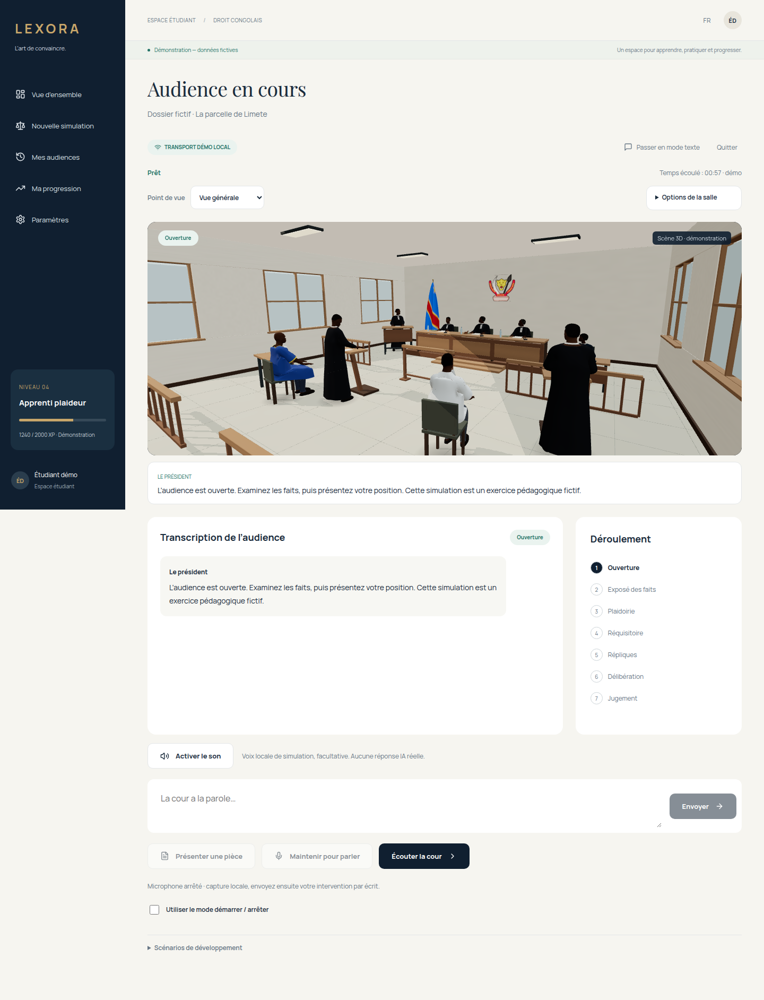

# Frontend unifié — salle et préparation

Cette branche réunit le guide compact et la salle Skillforce v27. Le parcours de démonstration fonctionne sans backend : choix du rôle et du dossier, guide, notes, équipement, audience, pièces, résultat et débriefing. Le guide de démonstration utilise des conseils prédéfinis ; aucune IA n’est appelée depuis le navigateur.



[Voir la version mobile](images/courtroom-adapted-mobile.png)

## Démarrer

```sh
npm ci
cp .env.example .env
npm run dev
```

Le mode serveur est raccordé à Django. Utiliser explicitement `VITE_APP_MODE=demo` pour la démonstration autonome. Ouvrir `/app` et préparer une simulation. Le mode texte permet d’entrer rapidement dans l’audience ; « Voir la salle 3D » charge le décor et les personnages à la demande.

## Audience adaptée

- « Point de vue » : vue générale, intervenant ou place de l’étudiant.
- « Options de la salle » : qualité, sous-titres et explorateur indépendant.
- Sous-titres sous la scène, y compris sur mobile, pour ne pas masquer les personnages.
- Chargement par éléments avec accès immédiat au texte. Le brouillon est conservé lors du changement d’affichage.
- Rendu suspendu pendant les pauses et lorsque le document est caché ; simulation manuelle de validation sans rendu concurrent.

Les ressources 3D pèsent toujours environ 38 Mo au premier accès. Un indicateur compte les éléments prêts, pas les octets. La limite de deux minutes d’inactivité est renouvelée sur une progression effective. Les performances sur téléphone physique et réseau lent restent à mesurer ; le mode texte reste disponible.

## Branchement du backend

Le contrat proposé REST/WebSocket est conservé. Les rôles existants restent au nombre de sept dans les messages de session ; prévenu et témoin restent visibles dans la salle, et leurs séquences complètes se consultent dans l’explorateur. Aucun rôle serveur fictif n’est ajouté pour animer ces deux personnages.

Le canal de chargement et les caméras sont internes à la scène ; ils ne nécessitent aucun endpoint Django supplémentaire. Le guide utilise désormais `POST /api/cases/:caseId/guide`, implémenté dans Django avec contrôle de session et CSRF. Les notes privées ne sont pas envoyées au guide.

Voir [le contrat backend](backend-contract.md), [le guide](preparation-guide.md), [la salle et son import](../public/courtroom/README.md) et [la validation](validation.md). Le mode serveur ne bascule pas silencieusement vers la démonstration lorsque Django est absent.
