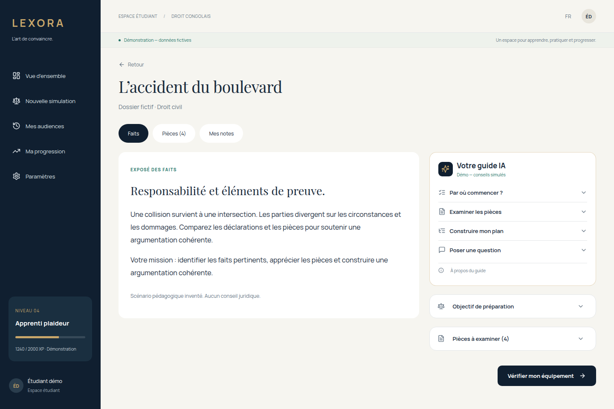

# Guide pédagogique de préparation — proposition frontend

Le guide apparaît sur `/app/cases/:caseId`, dans la colonne de préparation. Il aide à organiser une argumentation ; il ne promet pas une décision favorable et ne rend pas le jugement. Les conseils sont disponibles avant l’audience, sans modifier l’orchestration du procès.



## Présentation compacte

Le guide affiche quatre menus repliés par défaut. Une seule rubrique est ouverte à la fois ; chaque réponse se consulte par sous-menus (vue d’ensemble, étapes, questions et sources), sans empiler tous les échanges dans la page. Le contenu d’une rubrique reste dans une zone de hauteur limitée. La saisie apparaît seulement dans « Poser une question ». Les réponses reçues sont réutilisées à la réouverture ; « Actualiser les conseils » permet de demander une nouvelle réponse. Les blocs Objectif et Pièces de la colonne sont également repliables.

## Parcours

- « Par où commencer ? » : comprendre le différend et établir une grille faits/pièces/limites.
- « Examiner les pièces » : questionner la portée de chaque pièce du dossier ; les liens ouvrent l’onglet Pièces.
- « Construire mon plan » : position, faits utiles, arguments, contradiction et demande finale.
- Question libre, limitée à 1 500 caractères.
- Ajout explicite du dernier plan aux notes locales, en conservant les notes existantes et leur limite de 10 000 caractères. Les références fournies sont conservées dans le plan lorsqu’elles existent.

L’interface conserve les six échanges les plus récents en mémoire, pour ce dossier et ce rôle. Changer de dossier/rôle ou recharger la page réinitialise les échanges ; les notes explicitement ajoutées restent locales. Les réponses sont rendues en texte, sans HTML exécutable. Aucune réponse du guide ne modifie les scores ou XP.

## Démonstration

Le libellé « Démo — conseils simulés » est visible. Les réponses sont prédéfinies, contextualisées à partir du dossier et de ses pièces. Ce mode ne contacte aucun modèle ou fournisseur, ne téléverse aucune note et ne simule pas une citation juridique. Une question sur un article de loi signale l’absence de références validées au lieu d’inventer une règle.

## Mode serveur : endpoint proposé

**Non implémenté dans ce dépôt backend, non validé sur Django réel.** Le client suit les mêmes cookies de session, CSRF et contrôles d’erreur que le reste de l’application.

`POST /api/cases/:caseId/guide`

```json
{
  "clientMessageId": "uuid-stable-pour-reessai",
  "roleId": "defense",
  "intent": "method",
  "message": "Quelle méthode suivre pour préparer ce dossier ?",
  "history": []
}
```

`intent` : `method`, `evidence`, `outline` ou `question`. `history` contient au plus 12 messages `{role:"student"|"guide",text}`. Le contexte du guide envoyé dans l’historique est borné à 6 000 caractères par message. Les notes personnelles ne sont jamais lues ou ajoutées à cette requête. Les faits et pièces autorisés doivent être retrouvés côté Django depuis `caseId`, sans faire confiance au navigateur pour les droits ou le contexte juridique.

Réponse attendue :

```json
{
  "id": "guide-response-1",
  "caseId": "accident",
  "clientMessageId": "uuid-stable-pour-reessai",
  "introduction": "Commençons par séparer faits observés et éléments contestés.",
  "steps": [
    {
      "title": "Examiner le constat",
      "detail": "Relevez ce qui est décrit et ce qui reste à établir.",
      "exhibitIds": ["P01"]
    }
  ],
  "questions": ["Quel fait souhaitez-vous établir avec cette pièce ?"],
  "citations": []
}
```

Les schémas exacts, limites et types figurent dans `src/services/contracts.ts` et l’OpenAPI généré. Une réponse pour un autre dossier, un autre clientMessageId ou une pièce absente est refusée par le frontend. Les citations, si fournies, utilisent le schéma existant `citationSchema` ; aucun article n’est généré côté navigateur.

## Responsabilités Django / IA

- Vérifier session, accès au dossier, rôle autorisé et limites d’usage.
- Appeler le modèle exclusivement côté serveur et conserver les secrets côté Django.
- Encadrer l’IA comme tuteur méthodologique : demander à l’étudiant de raisonner, relever les incertitudes et préparer la contradiction ; ne pas garantir le gain du litige ni révéler un verdict futur.
- Traiter questions, historique et contenu des pièces comme des données non fiables, sans les laisser remplacer les instructions du système.
- Fournir des sources juridiques vérifiées par le système documentaire lorsqu’une règle est citée ; sinon expliquer que la référence manque. Ne pas inventer de loi ou d’article.
- Rendre les réessais idempotents par utilisateur, dossier et clientMessageId ; le frontend conserve le même identifiant lors d’un réessai.
- Fournir des erreurs appropriées (401/403/429/503), sans bascule silencieuse vers des réponses fictives.
- Décider de la politique de conservation des conversations ; le frontend ne les persiste pas. Les notes privées restent hors du contexte transmis.

Le client annule sa requête au changement de page et limite son attente à 20 secondes. L’annulation HTTP ne garantit pas, à elle seule, l’arrêt d’une tâche de génération côté serveur. Une erreur conserve la question et propose un réessai explicite ; un brouillon modifié après une erreur n’est pas effacé par l’acceptation d’une ancienne question.
